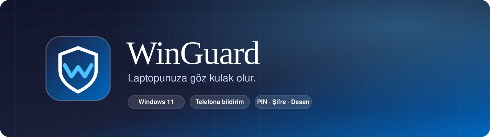
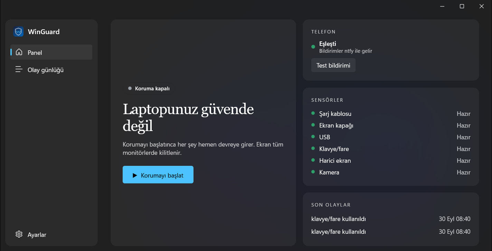

<div align="center">



<br />

[](https://github.com/Fatal-IV/WinGuard-releases/releases/latest)

[](https://github.com/Fatal-IV/WinGuard-releases/releases/latest)
[](https://github.com/Fatal-IV/WinGuard-releases/releases)


**Siz uzaktayken cihazınıza dokunulursa ekranı kilitler, sirenle uyarır ve telefonunuza bildirim gönderir.**

</div>

<br />

## Üç adımda hazır

<table>
<tr>
<td width="33%" valign="top">

### 1 · Kurun
`WinGuard-Setup.exe`'yi çalıştırın. Kurulum tek tıktır.

</td>
<td width="33%" valign="top">

### 2 · Eşleştirin
Telefonunuzla QR kodu okutun. Bildirimler anında gelir.

</td>
<td width="33%" valign="top">

### 3 · Başlatın
Panelden **Korumayı başlat**'a basın ve masanızdan kalkın.

</td>
</tr>
</table>

<div align="center">

</div>

<br />

## Ne yapar?

Korumayı başlattığınızda WinGuard bilgisayarınızı nöbete alır. Şarj kablosu çıkarılır, kapak kapatılır, USB takılır ya da klavyeye/fareye dokunulursa **tam ekran kilit** açılır. Kilit bilginizi doğru girmezseniz siren çalar ve telefonunuza anında bildirim gider.

<table>
<tr>
<td width="33%" valign="top">

#### 🔌 Beş sensör
Şarj kablosu, ekran kapağı, USB, klavye/fare ve harici ekran. Hangilerinin açık olacağını siz seçersiniz.

</td>
<td width="33%" valign="top">

#### 🖥️ Tam ekran kilit
Tüm monitörleri kaplar. Alt+Tab, Win tuşu ve benzeri kısayollar engellenir.

</td>
<td width="33%" valign="top">

#### 📱 Telefona bildirim
[ntfy](https://ntfy.sh) ile anlık bildirim. Sunucu kurmanız gerekmez.

</td>
</tr>
<tr>
<td valign="top">

#### 🔐 PIN, şifre ya da desen
Kilidi nasıl açacağınızı siz seçersiniz. Yanlış denemeler sınırlanır.

</td>
<td valign="top">

#### 📷 Kamera fotoğrafı
İsteğe bağlı: uyarıda ve yanlış girişte fotoğraf çeker. Telefona gönderme ayrı bir anahtardır ve varsayılan olarak kapalıdır.

</td>
<td valign="top">

#### 🛡️ Nöbet sertleştirmesi
Nöbet sürerken Görev Yöneticisi, Ctrl+Alt+Del seçenekleri ve güç düğmesi kısıtlanır.

</td>
</tr>
<tr>
<td valign="top">

#### ⌨️ Win+L ile başlat
İsteğe bağlı: Win+L Windows'u kilitlemek yerine korumayı başlatır.

</td>
<td valign="top">

#### 🐕 Bekçi süreci
Uygulama kapatılmaya çalışılırsa arka planda yeniden başlatır.

</td>
<td valign="top">

#### ⚡ Anında ya da geri sayımlı
Korumayı hemen başlatın ya da kalkmanız için bir geri sayım ayarlayın.

</td>
</tr>
</table>

## Kilidi nasıl açarsınız?

Kurulumda bir yöntem seçersiniz. **Ayarlar → Güvenlik** bölümünden istediğiniz zaman değiştirebilirsiniz. Değiştirmek için önce mevcut bilginizi doğrulamanız gerekir.

| Yöntem | Nasıl çalışır |
|---|---|
| 🔢 **PIN** | 4-8 haneli rakam. Ekrandaki tuş takımıyla ya da klavyeyle girilir. |
| 🔑 **Şifre** | En az 6 karakter; harf, rakam, sembol ve boşluk serbest. |
| ✋ **Desen** | 3×3 noktada en az 4 nokta. Dokunmatik ekranı olan cihazlarda sunulur; dokunarak ya da fareyle çizilir. |

Hiçbiri düz metin olarak saklanmaz; yalnızca özeti tutulur ve yalnızca sizin Windows hesabınızla çözülebilir.

## Kurulum

1. [**Son sürümü indirin**](https://github.com/Fatal-IV/WinGuard-releases/releases/latest) (`WinGuard-Setup.exe`).
2. Çalıştırın ve yönetici iznini onaylayın.
3. WinGuard'ı açın, kilit yönteminizi belirleyin ve telefonunuzla QR kodu okutun.
4. Panelden **Korumayı başlat**'a basın.

> **Not:** Kurucu şu an bir geliştirici test sertifikasıyla imzalıdır. Windows SmartScreen bir uyarı gösterebilir; "Ek bilgi → Yine de çalıştır" ile devam edebilirsiniz. Güvenmek istemiyorsanız dosyanın özetini aşağıdaki gibi doğrulayabilirsiniz.

<details>
<summary><b>İndirdiğiniz dosyayı doğrulama</b></summary>

<br />

Her sürümde kurucunun yanında bir `WinGuard-Setup.exe.sha256` dosyası bulunur. PowerShell'de:

```powershell
(Get-FileHash .\WinGuard-Setup.exe -Algorithm SHA256).Hash
```

Çıkan değer `.sha256` dosyasındaki ile aynı olmalıdır.

</details>

### Güncelleme

Güncellemeler uygulamanın içinden gelir: WinGuard yeni sürümü açılışta ve saatte bir denetler. **Ayarlar → Güncellemeler** bölümünden **Şimdi denetle**'ye basarak elle de bakabilirsiniz. Ayarlarınız ve kilit bilginiz güncellemede korunur. Otomatik denetimi aynı yerden kapatabilirsiniz.

## SSS

<details>
<summary><b>Telefonumu nasıl eşleştiririm?</b></summary>

<br />

WinGuard bildirimleri için ücretsiz **ntfy** uygulamasını kullanır (Android ve iOS).

1. Telefonunuza ntfy uygulamasını kurun. Kurulum sihirbazındaki ilk QR sizi doğru mağazaya götürür.
2. İkinci QR'ı okutun; uygulama sizin için rastgele oluşturulmuş kanala kendiliğinden abone olur.
3. Web sayfasını açık tutmanız gerekmez. Bildirimler uygulamaya arka planda gelir.

Kanal adı rastgele ve tahmin edilemezdir. İstediğiniz zaman **Ayarlar → Bildirim → Yeni QR oluştur** ile yeni bir kanal üretebilirsiniz; eski kanal geçersiz olur.

</details>

<details>
<summary><b>Gizlilik ve güvenlik nasıl sağlanıyor?</b></summary>

<br />

- Kilit bilgisi (PIN, şifre ya da desen) düz metin olarak saklanmaz, özeti tutulur. Bildirim kanal adı yalnızca sizin Windows hesabınızla çözülebilecek şekilde şifrelenir.
- Kamera fotoğrafları cihazınızda kalır. **Telefona gönder** açıksa fotoğraf, herkese açık bir sunucu olan ntfy.sh üzerinden iletilir; bu yüzden varsayılan olarak kapalıdır.
- Kamera çekimi sırasında kamera ışığı yanar; bunu gizlemek mümkün değildir.
- Bu depo yalnızca indirmeleri içerir. Kaynak kod herkese açık değildir.

</details>

<details>
<summary><b>Kilit bilgimi unutursam ne olur?</b></summary>

<br />

Şu an bir kurtarma seçeneği yoktur. Kilit bilginizi güvenli bir yerde saklayın.

</details>

<details>
<summary><b>Bilinen sınırlar</b></summary>

<br />

- **Ctrl+Alt+Del** Windows tarafından yönetilir; uygulama bu kısayolu engelleyemez, yalnızca ekrandaki seçenekleri kısıtlar.
- Güvenli Mod ya da yönetici hesabı olan biri korumayı aşabilir. WinGuard bir güvenlik duvarı değil, caydırıcı bir uyarı sistemidir.

</details>

## Sistem gereksinimleri

- Windows 11
- İnternet bağlantısı (telefon bildirimleri için)

<br />

<div align="center">

**[⬇ Son sürümü indir](https://github.com/Fatal-IV/WinGuard-releases/releases/latest)** · [Tüm sürümler](https://github.com/Fatal-IV/WinGuard-releases/releases)

<sub>WinGuard © Fatal-IV</sub>

</div>
